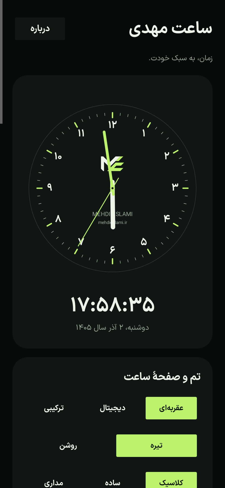
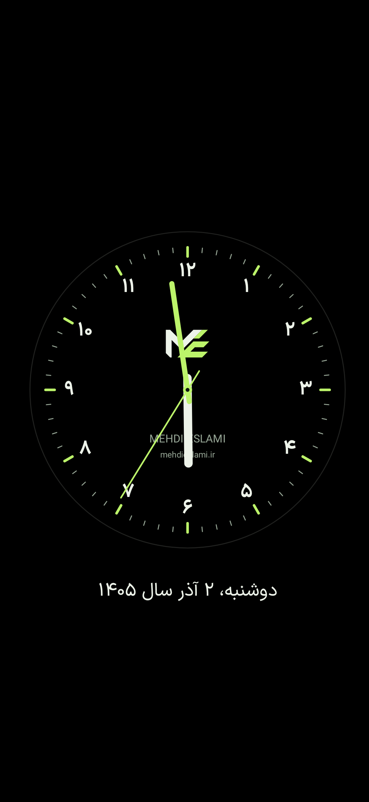

# ساعت مهدی

[English](README.md) · [دانلود فایل نصب](https://github.com/MehdiEslami1221/mehdi-clock/raw/refs/heads/main/downloads/MehdiClock-1.1.1.apk) · [نسخه‌های منتشرشده](https://github.com/MehdiEslami1221/mehdi-clock/releases)

ساعت مهدی یک برنامهٔ اندرویدی با ویجت قابل تغییر اندازه، تاریخ شمسی و تنظیمات ظاهر است. می‌توانی آن را روی صفحهٔ اصلی بگذاری، تمام‌صفحه باز کنی یا به‌عنوان اسکرین‌سیور و پس‌زمینهٔ زنده انتخاب کنی.

برنامه با جاوا و ابزارهای خود اندروید نوشته شده و روی **اندروید ۱۲ به بالا** نصب می‌شود. برای کار کردن به اینترنت و حساب کاربری نیاز ندارد و تبلیغات هم ندارد.

## تصاویر برنامه

| تنظیمات ساعت | ساعت تمام‌صفحه |
| --- | --- |
|  |  |

این تصاویر از نمای واقعی صفحه‌های برنامه، هنگام اجرای بررسی‌های رابط کاربری با رندر بومی اندروید روی API 35 گرفته شده‌اند.

## امکانات

- ساعت عقربه‌ای، دیجیتال و ترکیبی، با سه طرح برای صفحهٔ عقربه‌ای.
- تم روشن و تیره، رنگ‌های آماده و انتخاب رنگ دلخواه.
- ویجت قابل تغییر اندازه، با تنظیمات جداگانه برای هر ویجت.
- نمایش تاریخ شمسی، میلادی یا هر دو، همراه با روز هفته.
- تغییر دو سطر متن روی ساعت؛ لوگوی اصلی ثابت می‌ماند.
- اسکرین‌سیور اندروید، ساعت تمام‌صفحه و پس‌زمینهٔ زنده.
- پس‌زمینهٔ شب، تنظیم روشنایی اسکرین‌سیور و جابه‌جایی آرام ساعت.
- اعداد فارسی یا انگلیسی روی صفحهٔ عقربه‌ای، ثانیه‌شمار اختیاری و ساعت دیجیتال ۱۲ یا ۲۴ ساعته.
- انتخاب زمان گوشی، تهران یا UTC.

تاریخ شمسی داخل گوشی محاسبه می‌شود و برای سال‌های بعد به فایل تقویم جدید نیاز ندارد. ساعت داخل برنامه و اسکرین‌سیور به‌صورت برداری رسم می‌شود. تصویر ویجت هم متناسب با اندازهٔ واقعی آن ساخته می‌شود و محدودیت حافظهٔ اندروید را رعایت می‌کند.

## نصب

۱. [فایل MehdiClock-1.1.1.apk را دانلود کن](https://github.com/MehdiEslami1221/mehdi-clock/raw/refs/heads/main/downloads/MehdiClock-1.1.1.apk).

۲. فایل را روی گوشی باز و نصب کن. ممکن است اندروید اجازهٔ نصب را از برنامه‌ای که فایل را با آن باز کرده‌ای بخواهد.

۳. برنامهٔ «ساعت مهدی» را باز کن و ظاهر ساعت را تنظیم کن.

فایل نصب، نسخهٔ توسعه با امضای ثابت پروژه است. [کد SHA-256 فایل](downloads/SHA256SUMS) هم برای بررسی دانلود قرار داده شده است.

اگر نسخهٔ اولیهٔ **۱.۰.۰** را داری، قبل از نصب این نسخه آن را حذف کن؛ امضای این دو نسخه متفاوت است. با حذف برنامه، تنظیمات قبلی پاک می‌شود و باید ویجت‌ها را دوباره اضافه کنی.

## گذاشتن ویجت روی صفحهٔ اصلی

از داخل برنامه «افزودن ویجت به صفحهٔ اصلی» را بزن. راه دیگر این است که روی فضای خالی صفحهٔ اصلی نگه داری، بخش ویجت‌ها را باز کنی و «ساعت مهدی» را انتخاب کنی.

برای تغییر اندازه، روی ویجت نگه دار و دستگیره‌های اطراف آن را بکش. برای تغییر ظاهر، روی خود ویجت بزن و در پایان «ذخیرهٔ تنظیمات ویجت» را انتخاب کن. اندازه‌های قابل انتخاب به لانچر گوشی بستگی دارد.

تنظیمات داخل برنامه، پیش‌فرض ویجت‌های تازه است. هر ویجت می‌تواند رنگ، اندازه و منطقهٔ زمانی خودش را داشته باشد. زمان ویجت را اندروید به‌روز نگه می‌دارد. تاریخ هم خودکار تازه می‌شود، ولی محدودیت‌های باتری ممکن است به‌روزرسانی آن را حوالی نیمه‌شب به تأخیر بیندازد.

## اسکرین‌سیور و صفحهٔ قفل

این گزینه‌ها در بخش «اسکرین‌سیور و ساعت تمام‌صفحه» هستند:

| گزینه | کاربرد |
| --- | --- |
| اجرای ساعت تمام‌صفحه | ساعت را همان لحظه باز می‌کند. با دو بار لمس بسته می‌شود و قفل امنیتی گوشی را باز نمی‌کند. |
| انتخاب اسکرین‌سیور | تنظیمات اندروید را باز می‌کند تا «ساعت مهدی» را انتخاب کنی. معمولاً هنگام شارژ و پس از بی‌استفاده‌ماندن گوشی اجرا می‌شود. |
| پس‌زمینهٔ زنده | صفحهٔ انتخاب پس‌زمینه را باز می‌کند. امکان انتخاب آن برای صفحهٔ قفل به گوشی بستگی دارد. |

دکمهٔ پاور همچنان می‌تواند صفحه را خاموش کند. این حالت‌ها جایگزین Always On Display خود گوشی نیستند و ممکن است ساعت اصلی صفحهٔ قفل هم نمایش داده شود.

## ساخت پروژه

پوشهٔ پروژه را در Android Studio باز کن. برای ساخت از خط فرمان، JDK 17 و Android SDK 35 لازم است:

```sh
./gradlew assembleDebug testDebugUnitTest lintDebug
```

در ویندوز:

```powershell
.\gradlew.bat assembleDebug testDebugUnitTest lintDebug
```

خروجی نصب در مسیر `app/build/outputs/apk/debug/app-debug.apk` ساخته می‌شود.

بررسی‌های خودکار شامل تاریخ شمسی، تغییر روز در زمان تهران، تنظیمات مستقل ویجت‌ها، رسم ساعت و اجرای صفحه‌های برنامه روی اندروید ۱۲ و ۱۵ هستند. تصاویر بالا هم با اجرای بررسی رابط کاربری گرفته می‌شوند. ساخت و بررسی پروژه در GitHub Actions انجام می‌شود.

جزئیات ساخت، امضا و اجرای بررسی‌ها در [راهنمای فنی](docs/BUILDING.md) آمده است.

## فونت و لوگو

فونت برنامه ایران‌سنس ایکس است و مجوز خودش را دارد. لوگوی ME هم نشان شخصی سازنده است؛ قرار گرفتن این فایل‌ها در مخزن به معنی مجوز جداگانه برای استفادهٔ مجدد از آن‌ها نیست.

## سازنده

**مهدی اسلامی — Mehdi Eslami**

[وب‌سایت](https://mehdieslami.ir/) · [گیت‌هاب](https://github.com/MehdiEslami1221) · [لینکدین](https://www.linkedin.com/in/mehdi-eslami/) · [اینستاگرام](https://www.instagram.com/mage.code/)
