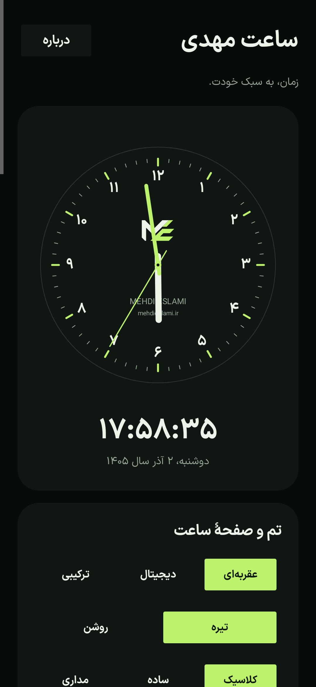
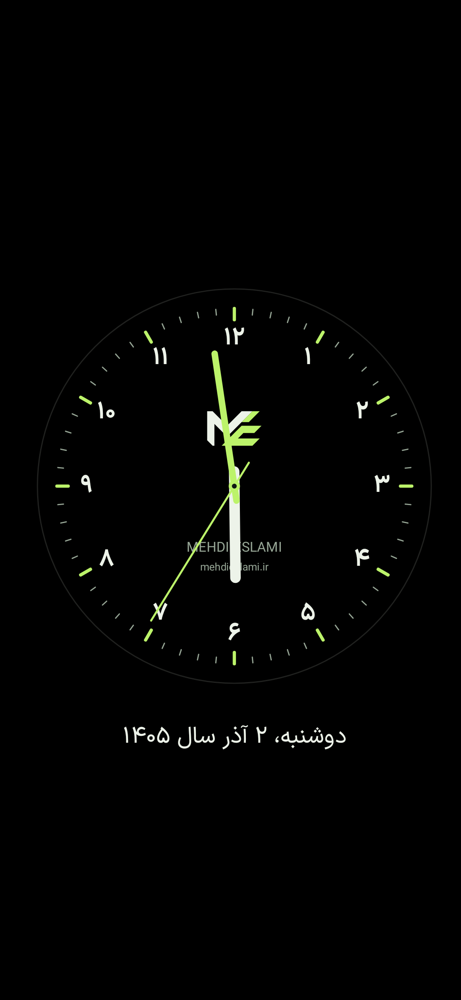

# Mehdi Clock

[راهنمای فارسی](README.fa.md) · [Download APK](https://github.com/MehdiEslami1221/mehdi-clock/raw/refs/heads/main/downloads/MehdiClock-1.1.1.apk) · [Releases](https://github.com/MehdiEslami1221/mehdi-clock/releases)

An Android clock with resizable widgets, Persian dates and a clock face you can make your own. It works offline and has no accounts, ads or analytics.

Built with Java and the Android SDK. **Android 12 or newer** is required.

## Screenshots

| Clock settings | Full-screen clock |
| --- | --- |
|  |  |

These images are captured from the app's Activity views with native Android graphics in the UI checks on API 35.

## What it does

- Analog, digital and hybrid clocks, with three analog face designs.
- Dark and light themes, five color presets and a custom color picker.
- Resizable home-screen widgets. Each widget keeps its own appearance and time zone.
- Persian and Gregorian dates, with an optional weekday. The Persian calendar is calculated on the device and needs no yearly data file.
- Two editable text lines, with the original ME logo kept in place.
- Native Android screensaver, full-screen clock and live wallpaper.
- Night background, adjustable screensaver brightness and gentle clock movement.
- Persian or Latin dial numerals, an optional second hand and a 12/24-hour digital clock.
- Device time, Tehran time or UTC.

The app and screensaver draw the clock as vectors. Widgets render their images to suit their actual size, within Android's memory limits.

## Install

1. [Download MehdiClock-1.1.1.apk](https://github.com/MehdiEslami1221/mehdi-clock/raw/refs/heads/main/downloads/MehdiClock-1.1.1.apk).
2. Open the APK on your phone and install it. Android may ask you to allow installation from the app you opened it with.
3. Open **ساعت مهدی** and choose your preferred clock.

The downloadable APK is a development build signed with the project's retained signing key. Its [SHA-256 checksum](downloads/SHA256SUMS) is included.

If you still have the early **1.0.0** build, uninstall it before installing 1.1.1 because the signing certificates differ. This clears its preferences, so add your widgets again afterward.

## Add a widget

Tap **افزودن ویجت به صفحهٔ اصلی** in the app. You can also hold an empty area of your home screen, open Widgets and choose **ساعت مهدی**.

Hold a widget and drag its handles to resize it. Tap it to change its settings, then choose **ذخیرهٔ تنظیمات ویجت**. App settings become the defaults for new widgets; existing widgets can keep different colors and time zones.

Widget time is maintained by Android. The date refreshes automatically, though battery restrictions can delay its update around midnight.

## Screensaver and lock screen

The **اسکرین‌سیور و ساعت تمام‌صفحه** section offers three ways to use the clock:

| Option | How it works |
| --- | --- |
| Full-screen clock | Opens immediately. Double-tap to exit. It can appear above the lock screen without unlocking the phone. |
| Android screensaver | Select **ساعت مهدی** in Android's screensaver settings. It usually runs while charging or docked after inactivity. |
| Live wallpaper | Opens Android's wallpaper picker. Lock-screen availability depends on the phone. |

The power button can still turn the display off. These modes do not replace the phone's Always On Display, and its own lock-screen clock may remain visible.

## Build and test

Open the project in Android Studio, or build it from a terminal with **JDK 17** and **Android SDK 35**:

```sh
./gradlew assembleDebug testDebugUnitTest lintDebug
```

On Windows:

```powershell
.\gradlew.bat assembleDebug testDebugUnitTest lintDebug
```

The APK is generated at `app/build/outputs/apk/debug/app-debug.apk`.

The tests cover Persian dates and Tehran midnight rollover, per-widget preferences, clock rendering, activity startup and service permissions on Android 12 and Android 15. A separate test captures the screenshots above. GitHub Actions runs the build and checks on pushes and pull requests.

See [the build guide](docs/BUILDING.md) for signing, screenshots and device checks.

## Project structure

| Component | Role |
| --- | --- |
| `MainActivity` | Clock preview, appearance settings and widget configuration |
| `ClockArt` / `ClockView` | Clock face, hands, text and logo rendering |
| `ClockWidget` / `Settings` | Home-screen widgets and saved preferences |
| `CalendarDates` | Persian/Gregorian calendars and time-zone calculations |
| `SaverView` / `ClockDreamService` | Full-screen content and Android screensaver |
| `FullScreenClockActivity` / `ClockWallpaperService` | Manual full-screen clock and live wallpaper |

## Fonts and branding

The app uses IRANSansX Regular and Bold. These font files retain their own license. The ME logo is personal branding; including the assets here does not grant a separate license to reuse them.

## Developer

**Mehdi Eslami** — [Website](https://mehdieslami.ir/) · [GitHub](https://github.com/MehdiEslami1221) · [LinkedIn](https://www.linkedin.com/in/mehdi-eslami/) · [Instagram](https://www.instagram.com/mage.code/)
